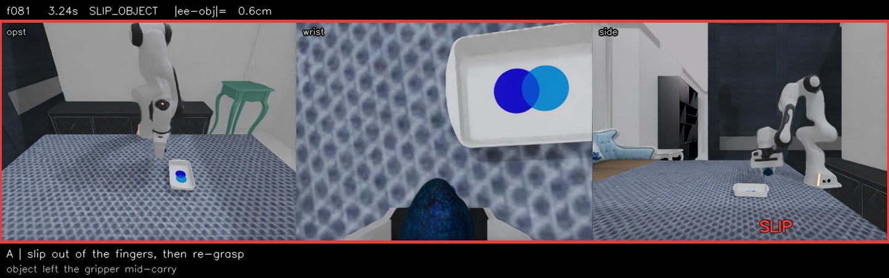
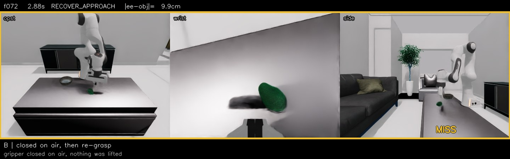
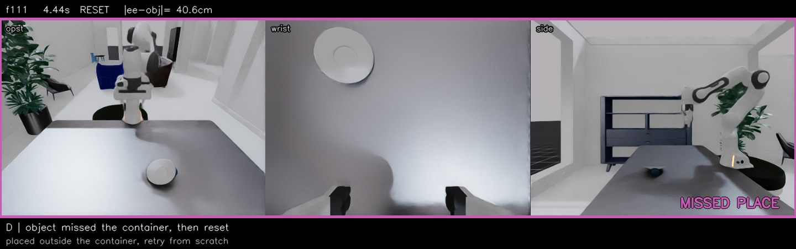
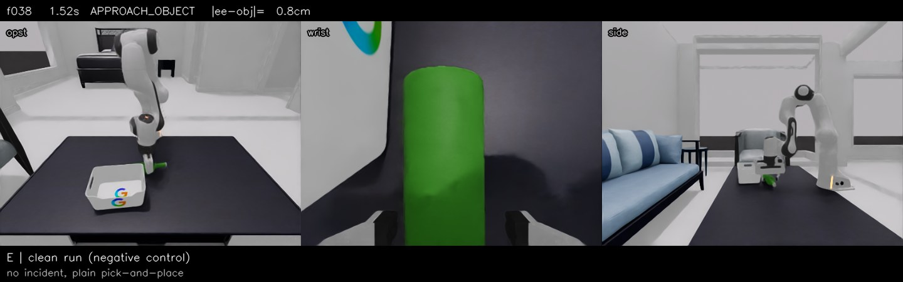

# dynamicvla-recovery-data

English | [简体中文](README.zh-CN.md)

A data factory for **failure-recovery trajectories**, built on the
[DynamicVLA](https://github.com/hzxie/DynamicVLA) DOM simulation stack
(Isaac Sim 4.5.0 / Isaac Lab 2.2.1).

The DOM dataset contains 200,000 successful episodes. In it, `slipping + lost`
accounts for **1.34%** of all frames — a model trained on DOM almost never sees
a grasp fail. This repository generates the missing cases: objects that slip
out of the gripper, grasps that close on air, objects pushed away mid-approach,
and placements that miss the target. On the A-class profile the accident-label
density reaches **49.35%**, a 37× increase over DOM.

The pipeline runs on a single consumer GPU. No model weights are needed; only
the simulator.

## Demo

Four episodes straight out of the pipeline. Three cameras side by side
(opst / wrist / side), with the frame counter, elapsed time, state-machine
phase and `|ee−obj|` distance in the top bar. The incident window is boxed,
and the caption underneath says what the clip is showing. Click a thumbnail
to play.

| Class | One episode | What happens in the clip |
| --- | --- | --- |
| **A**<br>slip → re-grasp | [](assets/demo/recovery_a_slip.mp4) | The gripper stays closed the whole time while contact friction drops to μ=0.02 and the mass is scaled ×8, so the object slides out from between the fingers and lands on the table. The arm sinks back down, re-aims and grasps again, then finishes the placement. 191 frames; the slip is at frame 81. |
| **B**<br>miss → re-grasp | [](assets/demo/recovery_b_miss.mp4) | The first grasp is offset 5 cm sideways, so the fingers close on air. Ten frames into the lift the object has not risen at all, the empty grasp is caught, and the arm backs off to try again. The object never leaves the table — that is what separates B from A. 167 frames. |
| **D**<br>missed place → redo | [](assets/demo/recovery_d_place.mp4) | The object fails to land in the bowl. Five consecutive frames judge it unplaced, the whole sequence resets and runs again. The clip covers two failure-and-retry rounds. |
| **E**<br>clean control | [](assets/demo/recovery_e_control.mp4) | No injection at all: a plain successful trajectory. Its job is to keep the model from learning "any anomaly means retry". |

### Verification status per class

Yield tells you how many episodes were kept. It does not tell you whether the
recovery path was actually exercised — the two diverge, so calibration has to
look at state codes.

| Class | Mechanism | Status |
| --- | --- | --- |
| A slip | friction 0.02 + mass ×8, object slides out of the fingers | ✅ verified: `sm` contains 10/11/12 |
| B miss | 5 cm first-grasp offset + lift check | ✅ verified: `sm` contains 12 (episode budget must be 45 s; at 30 s every genuine miss times out) |
| C push | lateral impulse + `REC_DRIFT_TOL` stale-plan gate | ⚠️ injection and gate are in; re-localisation samples are not yet produced reliably — see the correction note in `docs/01` |
| D missed place | `is_object_placed` false → RESET | ⚠️ the clip above happened **naturally**; the `REC_PLACE_OFFSET` injection is still being validated |
| E control | no injection | ✅ verified: `sm` contains none of 1/10/11/12/13 |

All four clips are rendered straight from the raw h5 by
`过程文件/质检episode/make_demo_clip.py`. The frame counter and state codes come
from `sm_state`; nothing in the overlay is hand-annotated.

## Why recovery data matters

The evaluation half of DynamicVLA makes the gap visible. Across 1,800 closed-loop
DOM trials, failures cluster into three shapes:

| Failure shape | Share of failures | What it means |
| --- | ---: | --- |
| Runs to the step limit without ever holding | 48.4% | The grasp never succeeded and was never retried |
| Stops early (≤ 0.55 × limit) | 26.7% | The object was being carried, something went wrong, the policy gave up |
| Other | 24.9% | — |

Two things follow. First, a dataset of clean successes gives the model no
supervision for the moment after a failure — there is nothing in DOM that says
"the object left your hand, go back and pick it up". Second, long-horizon DOM
tasks amplify the problem: 88% of them require two grasps, and the first grasp
is often off by 24.6 cm, so recovery behaviour is on the critical path rather
than an edge case.

The five profiles here are derived from those failure shares, not chosen
arbitrarily.

| Class | Scenario | Injection | Target failure | Episodes |
| --- | --- | --- | --- | ---: |
| **A** | Slip, then re-grasp | friction μ = 0.02, payload ×8, gripper stays closed | slip after grasp | 120 |
| **B** | Grasp on air, then retry | 5 cm lateral offset at first grasp, lift check fails, grasp again | no grasp | 75 |
| **C** | Object pushed away mid-approach | lateral velocity applied to the object while the arm approaches | object moved | 60 |
| **D** | Placement misses, second attempt | `is_object_placed` false for 5 frames → RESET | bad placement | 30 |
| **E** | Clean control | none | negative control | 15 |

Physics rationale and per-class yields are in
[`docs/01_scenario_design.md`](docs/01_scenario_design.md).

## Scope

What this repository actually does, verified on the pinned stack:

- Generates h5 and LeRobot v2.1 episodes for the five classes above, on the
  public upstream `hzxie/DynamicVLA` at commit `a27a06d`.
- Produces the same h5 layout as DOM, so the official converter
  (`scripts/create_lerobot_dataset.py`) accepts it without modification.
- Ships three independent acceptance layers: quality gates, a standalone
  loader check, and a delivery report.

What it does not do:

- `utils/event_labels.py` is **not** part of public upstream. It lives in our
  private `server_fullft` fork. Generation does not depend on it
  (`gen_recovery.py` imports only `simulate` and `place_recovery_sm`), but
  training-side label computation does. Either use a fork that has the file, or
  implement the labeler from [`docs/04_label_contract.md`](docs/04_label_contract.md).
- The generated h5 cannot be fed to `managed_train.py` directly: that script
  hard-codes the `hzxie/DOM` repo id and filters through `audit_dataset`
  (`docs/04` §8.1).
- `patches/apply_grasp_rise_patch.py` only applies to a fork that contains
  `event_labels.py`. `scripts/02` skips it silently when the file is absent.

In short: the simulation side is complete and reproducible; the training side
assumes you have your own fork.

## Fixed profile

| Component | Value |
| --- | --- |
| Upstream DynamicVLA | `a27a06d` |
| Isaac Sim | `4.5.0.0` |
| Isaac Lab | `2.2.1` (`isaaclab` 0.45.9) |
| Python / torch | 3.10 / 2.7.1+cu128 |
| Robot | Franka Panda |
| Control rate | 25 Hz (`dt = 0.04 s`) |
| Cameras | `opst` / `wrist` / `side`, 480×360, RGB + segmentation |
| Episode budget | 30 s for recovery generation, 12 s for the official place task |

## Measured throughput

Generation needs no model weights. A single 8 GB card is enough to run all five
classes serially.

| Setup | GPU memory | Utilisation | Throughput |
| --- | ---: | ---: | --- |
| RTX 5060 8 GB, one process | 5.7 GB | — | 37–41 s/attempt |
| RTX 4090 24 GB, one process | 9–10 GB | 17% | 37–41 s/attempt |
| **RTX 4090 24 GB, two processes** | **19 GB** | **33%** | **~28 s/attempt** |
| RTX 4090 24 GB, three processes | ≥ 28 GB | — | OOM |

Two processes is the ceiling on a 24 GB card. On an 8 GB card a second instance
deadlocks inside Omniverse Kit initialisation (it allocates 821 MiB and never
proceeds); the 4090 does not, which is why parallel production is only enabled
for 24 GB cards. Deployment scripts:
[`21_parallel_worker.sh`](scripts/21_parallel_worker.sh) and
[`22_supervisor_4090.sh`](scripts/22_supervisor_4090.sh). Yield is 30–40% of
attempts at a 30 s budget; a saved episode is 65–97 MB of h5.

Full measurements, including the 8 GB deadlock experiments and the correction
that the 4090 does not inherit that behaviour, are in
[`docs/07_concurrency_finding.md`](docs/07_concurrency_finding.md) §12 and
[`docs/08_4090_parallel.md`](docs/08_4090_parallel.md).

## Quick start

```bash
git clone <this-repo> && cd dynamicvla-recovery-data

# 1) upstream code at a pinned commit
bash scripts/00_setup.sh --upstream ~/dynamicvla-demo

# 2) assets (~2 GB, not distributed via git)
#    download from https://gateway.infinitescript.com/?f=DOM-Test
#                and https://gateway.infinitescript.com/?f=DOM-3D-Objects
bash scripts/01_fetch_assets.sh --zips ~/Downloads

# 3) inject the generator and the label patch
bash scripts/02_patch_upstream.sh --root ~/dynamicvla-demo

# 4) environment / assets / GPU / disk self-check
bash scripts/03_preflight.sh --root ~/dynamicvla-demo

# 5) concurrency probe — run this before trusting any throughput number
bash scripts/04_benchmark_single_card.sh --root ~/dynamicvla-demo --rounds 3

# 6) small batch
bash scripts/05_generate.sh --root ~/dynamicvla-demo --profile profiles/a_slip.env --n 4 --seed 9000

# 7) convert, gate, verify
bash scripts/07_convert_lerobot.sh --root ~/dynamicvla-demo --base ~/dvla-gen/a_slip
bash scripts/08_qa_gates.sh ~/dvla-gen/a_slip --profile a_slip
python scripts/09_verify_loader.py --dataset ~/dvla-gen/a_slip/lerobot_home/local/a_slip
python scripts/10_report.py --base ~/dvla-gen
```

Parallel production on a 24 GB card:

```bash
setsid nohup bash scripts/22_supervisor_4090.sh > /dev/null 2>&1 < /dev/null &
touch /root/gpufree-data/work/STOP      # graceful stop after the current round
```

## Data contract

Each episode is written as one `*.h5`, one `*.json`, and one
`events/<seed>.jsonl`, then converted to LeRobot v2.1.

| Key | Shape | Notes |
| --- | --- | --- |
| `action` | `(T, 8)` | pos 3 + quat 4 + gripper 1; gripper is index **7** |
| `ee_pos` / `ee_quat` | `(T,3)` / `(T,4)` | end-effector pose |
| `joints` | `(T,9)` | 7 arm joints + 2 fingers |
| `object_pos` / `object_quat` / `object_vel` | `(T,3)` / `(T,4)` / `(T,3)` | object ground truth; `object_vel` is high-precision |
| `sm_state` | `(T,)` | state-machine trace: `10=SLIP`, `11=SETTLE`, `12=RETRY`, `13=GIVE_UP` |
| `{opst,side,wrist}_cam_rgb` | `(T,360,480,3)` | three RGB streams |
| `{opst,side,wrist}_cam_seg` | `(T,360,480,1)` | segmentation |

After conversion the action becomes 7 columns (pos 3 + rotation vector 3 +
gripper 1, gripper at index 6). `sm_state` is dropped by the official converter,
so `annotate_recovery.py` extracts it into `recovery_index.json` alongside the
LeRobot dataset.

The `*.json` sidecar carries a `recovery` block:

```json
{"n_frames": 183, "slip_frame": 66, "settle_frame": 71, "retry_frame": 82,
 "giveup_frame": -1, "n_grasp_frames": 36, "has_slip": true, "has_retry": true}
```

Label contract (22 phase classes, 3 grasp classes, 15 spatial quantities) is in
[`docs/04_label_contract.md`](docs/04_label_contract.md).

## Quality gates

`payload/qa_gates.py` runs five gates. The design rule is to judge from physical
evidence rather than from what a log claims.

| Gate | Criterion | Rationale |
| --- | --- | --- |
| G1 config | `friction` slip mode | inferred from G2: gripper closed while the object leaves implies friction |
| G2 mechanism | gripper command is `-1` throughout the slip window | an open gripper means `open` mode, which is invisible to training |
| G3 geometry | ≥ 10 consecutive frames with `|p_ee − p_obj| > 5 cm` after slip | proves the object actually left the hand |
| G4 labels | `lost` fraction non-zero and non-degenerate | an all-`held` batch produced no accidents |
| G5 reproducibility | `run_config.json` present with ≥ 8 fields | parameter snapshot; prevents silent drift |

A-class measurement on 9 episodes: G2 9/9, G3 9/9, G4 `lost = 33.27%`,
accident labels `slipping + lost = 49.35%` against DOM's 1.34%.

## Known traps

Three defaults will silently ruin a batch if left alone.

| Trap | Symptom | Fix |
| --- | --- | --- |
| `REC_SLIP_MODE` defaults to `open` in `place_recovery_sm.py`, while the historical pipeline used `friction` | generated slips are invisible to training (gripper open, labels only `lost`) | export `REC_SLIP_MODE=friction` explicitly |
| `--require_slip` and `--keep_imperfect` are mutually exclusive, not additive | class B produces zero episodes because it has no slip | use `--keep_imperfect` for B/C/D/E |
| `REC_SLIP=1` with `MISS_OFFSET>0` puts two anomalies in one trajectory | episodes run to ~1000 frames, 0/9 finish within 30 s | `REC_SLIP=0` for class B, one variable at a time |

All five profiles assign every parameter with explicit `export`, and write a
`run_config.json` snapshot for the gates. The full list is in
[`docs/06_troubleshooting.md`](docs/06_troubleshooting.md).

## Repository layout

```
payload/     generator, recovery state machine, annotator, quality gates
profiles/    five recipe files, every parameter explicit
scripts/     00→10 production chain, 21→23 parallel production
patches/     grasp-rise prerequisite patch (see docs/05)
docs/        scenario design, scale, benchmarks, label contract, SOP, traps
```

## License

Our own code (`payload/`, `scripts/`, `patches/`, `annotate_recovery.py`,
`qa_gates.py`) is MIT. Upstream DynamicVLA and its USD assets are S-Lab License
1.0, non-commercial only; this repository redistributes neither, only download
and injection scripts. Isaac Sim and Isaac Lab require your own NVIDIA licences.

## Citation

```bibtex
@misc{dynamicvla-recovery-data,
  title  = {dynamicvla-recovery-data: a single-GPU factory for slip, miss and disturbance recovery trajectories},
  year   = {2026},
  note   = {Built on DynamicVLA (S-Lab, NTU). Non-commercial use only.}
}
```
