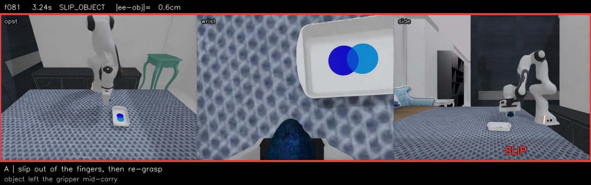
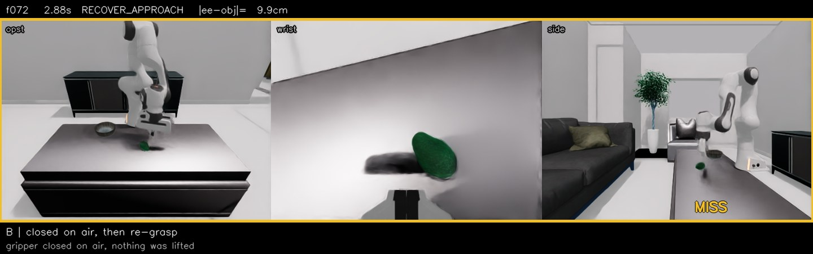
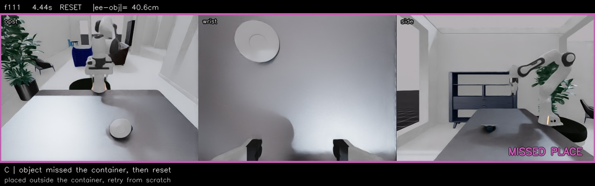
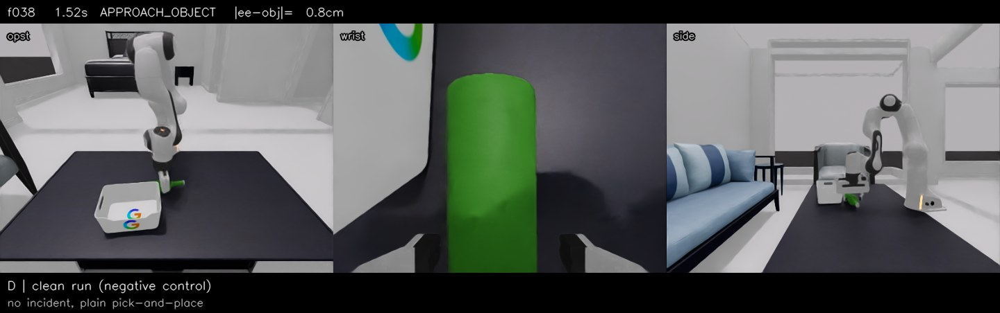

# dynamicvla-recovery-data

[English](README.md) | 简体中文

一套**失败—恢复轨迹**的数据工厂，建立在 [DynamicVLA](https://github.com/hzxie/DynamicVLA)
的 DOM 仿真栈之上（Isaac Sim 4.5.0 / Isaac Lab 2.2.1）。

DOM 数据集是 20 万条成功轨迹，其中 `slipping + lost` 只占全部帧的 **1.34%**——
用 DOM 训出来的模型几乎没见过抓取失败。本仓库生产它缺的那部分：物体从夹爪里滑出去、
夹爪闭合却夹在空气上、放置落到目标外。在 A 类配方上，
事故类标签密度达到 **49.35%**，是 DOM 的 37 倍。

整条管线在单张消费级显卡上就能跑，不需要模型权重，只需要仿真器。

> **当前状态（2026-11-03）**：A/B 两类配方经两项各约 40 分钟的标定后定稿
> （episode 预算 30 s→45 s、A 类配重 ×8→×4），已进入量产——A 类保存率
> 26%→35.8%，B 类 40%，类别纯度均 100%。标定数据、量产各轮实测与
> 工程坑见 [`docs/10_calibration_first_production.md`](docs/10_calibration_first_production.md)。

## 演示

四段 episode 直接从管线产出，三路相机并排（opst / wrist / side）。顶栏给帧号、时间、
状态机阶段和 `|ee−obj|` 距离，异常区间用色框标出。点图或下方链接播放。

### A · 滑脱后重抓

[](assets/demo/recovery_a_slip.mp4)

[观看 A 段完整 episode](assets/demo/recovery_a_slip.mp4)，191 帧 / 25 Hz。夹爪全程保持闭合，
接触摩擦降到 μ=0.02、质量 ×8，物体从两指之间滑出去落到台面；机械臂沉下来重新对准，
再抓一次，走完放置。滑脱发生在第 81 帧——这是唯一直接对应 slipping recall 的一段。

### B · 抓空后重试

[](assets/demo/recovery_b_miss.mp4)

[观看 B 段完整 episode](assets/demo/recovery_b_miss.mp4)，167 帧 / 25 Hz。首抓横向偏 5 cm，
夹爪闭合在空气上；抬升 10 帧后物体高度没变，判定空手，退回重新接近。物体从头到尾没离开
过桌面——这是与 A 的关键区别。

### C · 放偏后重放

[](assets/demo/recovery_c_place.mp4)

[观看 C 段完整 episode](assets/demo/recovery_c_place.mp4)，202 帧 / 12 fps。物体没落进碗里，
连续 5 帧判定「未放置」，整条流程回 RESET 重来。这段截取自一条 549 帧的 episode，
覆盖两轮失败到重试。

### D · 纯成功对照

[](assets/demo/recovery_d_control.mp4)

[观看 D 段完整 episode](assets/demo/recovery_d_control.mp4)，114 帧 / 15 fps。不注入任何扰动，
干净的成功轨迹。它的作用是防止模型把「有异常 = 应该重试」学成无条件重试。

### 四类的验证状态

产出率只说明「存下来了几条」，不说明「恢复路径真的被走过了」——两者会脱节，
校准时必须看状态码。下表是 2026-11-02 在 4090 上逐条查 `sm_state` 的实测结果。

| 类 | 机制 | 状态 | 实测有效率 |
| --- | --- | --- | --- |
| A 滑脱 | 摩擦降到 0.02 + 配重，物体从指间滑出 | ✅ 稳定。`--require_slip` 强约束，每条都含 10/11/12 | 30 s 基线约 26%；**量产配方（45 s + ×4）35.8%**，类别纯度 100% |
| B 抓空 | 首抓偏 5 cm + 抬升检测 | ✅ 稳定，但**必须过滤**：`--keep_imperfect` 会把干净轨迹一起存下来 | 保存率约 46%，其中真抓空仅 **3/8（37.5%）** |
| C 放偏 | `is_object_placed` 判假 → RESET | 🟡 **降级可用**。`REC_PLACE_OFFSET=0.06` 偏不够狠，真样本来自自然放偏 | 约 1/8（靠筛选） |
| D 对照 | 不注入 | ✅ 稳定，sm 不含 1/10/11/12/13 | 约 35–40% |

结论：**A / B / D 三类可稳定量产，量产优先级 A > B；C 靠自然样本筛选。**

> 原先还有一类「推进途中物体被推走 → 重定位」，已下线。原因不是调参：状态机
> 每帧按物体**实时位姿**重算抓取目标，物体被推走后机械臂只是安静地跟过去，系统里
> 根本不存在「过期计划」这个状态，闸门无从判断。20+ 次尝试、0 条有效样本。
> 若要监督「物体在动时的接触点外推」，正确做法是给物体一个初始线速度，
> 而不是造一条恢复路径。

⚠️ 三类「静默产废」的坑——产出率一个都发现不了，只有逐条查 `sm_state` 才暴露：

| 类 | 表面 | 真相 |
| --- | --- | --- |
| B | 8 条保存 | 只有 3 条真抓空，4 条是干净轨迹、1 条是放偏 |
| C | 5 条含 RESET | 主动注入的 6 cm 偏移没能让放置失败，RESET 来自抓取失败 |
| 已下线的推偏类 | 5 条含 RESET | RESET 全部由抓取/搬运失败触发，没有一条来自推走后的重定位 |

所以转换前必须先跑验收，见下节。

### 验收（转换前必做）

```bash
python scripts/25_verify_episode.py out/prod_a2 --expect A_slip --prune
python scripts/25_verify_episode.py out/prod_b2 --expect B_miss --prune
```

它会查三件事，任一不过就把该 episode 移到 `<batch>/_rejected/`：

1. **完整性** —— 每个数据集首维等于帧数、无 NaN、json 标注与 `sm_state` 一致
2. **相机活动性** —— 判据是首末帧差异。冻屏时渲染器读的 USD 停在初始位姿，
   首末帧逐像素相同；正常轨迹即使有大量静止等待帧，首末差异也在 80% 以上。
   （早期误用「逐帧变化中位数」当判据，会把 5% 的正常轨迹误判成冻屏。）
3. **类别** —— 按 `sm_state` 判类，`--expect` 不符即剔。C/D 还要看 RESET 的
   **触发前状态**：`≥8` 是放偏，`≤3` 是漂移，介于两者之间是抓取失败、不属于任何一类。

退出码 0/1，可以直接当生产闸门用。

四段视频由 `scripts/26_make_demo_clip.py` 从原始 h5 直接渲染，
叠加的帧号与状态码取自 `sm_state`，没有手工标注。

### 标定与首产（2026-11-03）

正式放量前各花约 40 分钟（实例费合计不到 ¥2）标定了两个凭经验定的参数，
两项都有效：

- **episode 预算 30 s → 45 s**：A 类 n=20 对照，保存率 35% vs 基线 26%，
  纯度均 100%。30 s 预算下「滑脱 + 静止 + 重抓 + 放置」经常踩线超时。
- **A 类配重 ×8 → ×4**：单变量扫描（每档 n=8）×2/×3 各 25%、×4 50%、
  ×6/×8 各 38%。×4 以最轻的配重达到本样本最高保存率——配重越轻，
  恢复段的物体动力学越接近真实分布。（每档 8 次是小样本，只支持
  「×4 优于 ×2/×3、与更大配重相当」的排序结论。）

量产配方（A：45 s + ×4；B：45 s）下的实测保存率：**A 35.8%**（120 次
尝试存 43 条）、**B 40.0%**（150 次存 60 条）。相比 docs/02 推算所用的
26% 基线，A 类同目标所需的 attempt 数约少 27%。轮与轮之间保存率有
30%–43% 的波动，同配方下更可能是抽样噪声而非趋势。

量产由 [`scripts/29_quota_runner.sh`](scripts/29_quota_runner.sh) 配额自驱：
按目标条数自动续轮、轮间零空转、种子自增可接续。全套标定数据、各轮
日志数字与三个工程坑（`--disable_fabric` 崩溃、`SIM_DIR` 秒退、后台化
抢跑）见 [`docs/10_calibration_first_production.md`](docs/10_calibration_first_production.md)。

## 为什么需要恢复数据

DynamicVLA 的评测部分把这个缺口暴露得很清楚。1,800 条闭环 DOM 试验里，失败形态集中：

| 失败形态 | 占全部失败 | 含义 |
| --- | ---: | --- |
| 一直尝试直到步数上限 | 48.4% | 抓取从未成功，也从未重试 |
| 中途早停（≤ 上限 × 0.55） | 26.7% | 已经在搬运，途中出事，策略放弃 |
| 其他 | 24.9% | — |

由此有两点。第一，全是成功轨迹的数据集，对「失败之后怎么办」没有任何监督信号——
DOM 里没有一条样本告诉模型「东西脱手了，回去捡起来」。第二，长程任务会放大这个问题：
88% 的 long-horizon 任务需要两次抓取，而第一次抓取常常偏离 24.6 cm，
恢复行为处在关键路径上，不是边缘情况。

下面四类配方按「修哪个指标」反推得出，不是随意设定。

| 类 | 场景 | 注入方式 | 对应失败 | 目标条数 |
| --- | --- | --- | --- | ---: |
| **A** | 滑脱后重抓 | 摩擦 μ = 0.02、配重 ×4（标定后量产值，基线 ×8），夹爪保持闭合 | 抓住后滑脱 | 165 |
| **B** | 抓空后重试 | 首抓横向偏移 5 cm，抬升检测失败，重新抓取 | 抓取失败 | 110 |
| **C** | 放偏后二次放置 | `is_object_placed` 连续 5 帧为假 → RESET | 放置失败 | 33 |
| **D** | 纯成功对照 | 不注入 | 负对照 | 22 |

目标条数为生产配额，每类含约 10% holdout（评测用，不进训练）。
物理机制与各类实际产出率见 [`docs/01_scenario_design.md`](docs/01_scenario_design.md)，
标定过程见 [`docs/10_calibration_first_production.md`](docs/10_calibration_first_production.md)。

## 范围

在固定版本栈上已验证的部分：

- 在公开上游 `hzxie/DynamicVLA`（commit `a27a06d`）上生成上述四类的 h5 与
  LeRobot v2.1 数据。
- 产出的 h5 布局与 DOM 一致，官方转换器
  （`scripts/create_lerobot_dataset.py`）无需修改即可处理。
- 三层独立验收：质量闸门、独立加载器检查、交付汇总。

不做、也不声称能做的部分：

- `utils/event_labels.py` **不在**公开上游，它存在于我们的私有 `server_fullft`
  fork 中。生成过程不依赖它（`gen_recovery.py` 只 import `simulate` 与
  `place_recovery_sm`），但训练侧的标签计算依赖。要么使用带该文件的 fork，
  要么按 [`docs/04_label_contract.md`](docs/04_label_contract.md) 自行实现标签器。
- 生成的 h5 不能直接喂给 `managed_train.py`：该脚本硬编码了 `hzxie/DOM`
  仓库名，并经过 `audit_dataset` 过滤（`docs/04` §8.1）。
- `patches/apply_grasp_rise_patch.py` 只对含 `event_labels.py` 的 fork 有意义。
  文件不存在时 `scripts/02` 会静默跳过该步骤。

概括来说：仿真侧是完整且可复现的，训练侧假设你已有自己的 fork。

## 固定配置

| 组件 | 值 |
| --- | --- |
| 上游 DynamicVLA | `a27a06d` |
| Isaac Sim | `4.5.0.0` |
| Isaac Lab | `2.2.1`（`isaaclab` 0.45.9） |
| Python / torch | 3.10 / 2.7.1+cu128 |
| 机器人 | Franka Panda |
| 控制频率 | 25 Hz（`dt = 0.04 s`） |
| 相机 | `opst` / `wrist` / `side`，480×360，RGB + 分割 |
| Episode 预算 | 恢复数据生成 45 s（A/B 量产配方，2026-11-03 标定采纳），官方 place 任务 12 s |

## 实测吞吐

生成不需要模型权重，一张 8 GB 卡即可串行跑完全部四类。

| 配置 | 显存 | 利用率 | 吞吐 |
| --- | ---: | ---: | --- |
| RTX 5060 8 GB，单进程 | 5.7 GB | — | 37–41 s/次尝试 |
| RTX 4090 24 GB，单进程 | 9–10 GB | 17% | 37–41 s/次尝试 |
| **RTX 4090 24 GB，双进程** | **19 GB** | **33%** | **~28 s/次尝试** |
| RTX 4090 24 GB，三进程 | ≥ 28 GB | — | OOM |

24 GB 卡的上限是两个进程。8 GB 卡上第二个实例会在 Omniverse Kit 初始化阶段死锁
（只申请 821 MiB 后停住），4090 上不会——所以并行生产只对 24 GB 卡开放。
部署脚本：[`21_parallel_worker.sh`](scripts/21_parallel_worker.sh)、
[`22_supervisor_4090.sh`](scripts/22_supervisor_4090.sh)；
[`29_quota_runner.sh`](scripts/29_quota_runner.sh) 在此之上按目标条数自驱续轮。
30 s 预算下产出率为尝试数的 26–40%；45 s 量产配方下 A 类 35.8%、B 类 40.0%
（单条 h5 体积 65–97 MB）。

完整测量（含 8 GB 死锁实验，以及「4090 不继承该行为」这一修正）见
[`docs/07_concurrency_finding.md`](docs/07_concurrency_finding.md) §12 与
[`docs/08_4090_parallel.md`](docs/08_4090_parallel.md)。

## 快速开始

```bash
git clone <this-repo> && cd dynamicvla-recovery-data

# 1) 拉取上游代码（固定 commit）
bash scripts/00_setup.sh --upstream ~/dynamicvla-demo

# 2) 下载资产（约 2 GB，不经 git 分发）
#    从 https://gateway.infinitescript.com/?f=DOM-Test
#     和 https://gateway.infinitescript.com/?f=DOM-3D-Objects 下载后：
bash scripts/01_fetch_assets.sh --zips ~/Downloads

# 3) 注入生成器与标签补丁
bash scripts/02_patch_upstream.sh --root ~/dynamicvla-demo

# 4) 环境 / 资产 / 显卡 / 磁盘自检
bash scripts/03_preflight.sh --root ~/dynamicvla-demo

# 5) 并发探测——在看任何吞吐数字之前先跑这一步
bash scripts/04_benchmark_single_card.sh --root ~/dynamicvla-demo --rounds 3

# 6) 小批试产
bash scripts/05_generate.sh --root ~/dynamicvla-demo --profile profiles/a_slip.env --n 4 --seed 9000

# 7) 转换、过闸门、验收
bash scripts/07_convert_lerobot.sh --root ~/dynamicvla-demo --base ~/dvla-gen/a_slip
bash scripts/08_qa_gates.sh ~/dvla-gen/a_slip --profile a_slip
python scripts/09_verify_loader.py --dataset ~/dvla-gen/a_slip/lerobot_home/local/a_slip
python scripts/10_report.py --base ~/dvla-gen
```

24 GB 卡上的并行生产：

```bash
setsid nohup bash scripts/22_supervisor_4090.sh > /dev/null 2>&1 < /dev/null &
touch /root/gpufree-data/work/STOP      # 当前轮跑完后优雅退出

# 或：配额自驱——按目标条数自动续轮，达标即停
echo 9600001 > /path/out/_seed_a
setsid nohup bash scripts/29_quota_runner.sh \
    profiles/a_slip_prod.env /path/out/prod3_a 158 /path/out/_seed_a \
    > /tmp/runner_a.log 2>&1 < /dev/null &
```

## 数据契约

每条 episode 先落一个 `*.h5`、一个 `*.json` 与 `events/<seed>.jsonl`，再转为 LeRobot v2.1。

| 键 | 形状 | 说明 |
| --- | --- | --- |
| `action` | `(T, 8)` | pos 3 + quat 4 + gripper 1，夹爪在索引 **7** |
| `ee_pos` / `ee_quat` | `(T,3)` / `(T,4)` | 末端位姿 |
| `joints` | `(T,9)` | 7 个手臂关节 + 2 个手指 |
| `object_pos` / `object_quat` / `object_vel` | `(T,3)` / `(T,4)` / `(T,3)` | 物体真值，`object_vel` 为高精度 |
| `sm_state` | `(T,)` | 状态机轨迹：`10=SLIP`、`11=SETTLE`、`12=RETRY`、`13=GIVE_UP` |
| `{opst,side,wrist}_cam_rgb` | `(T,360,480,3)` | 三路 RGB |
| `{opst,side,wrist}_cam_seg` | `(T,360,480,1)` | 分割 |

转换后 action 变为 7 列（pos 3 + 旋转向量 3 + gripper 1，夹爪在索引 6）。
`sm_state` 会被官方转换器丢弃，因此 `annotate_recovery.py` 先将其提取到
`recovery_index.json` 侧车文件中。

`*.json` 侧车带有 `recovery` 块：

```json
{"n_frames": 183, "slip_frame": 66, "settle_frame": 71, "retry_frame": 82,
 "giveup_frame": -1, "n_grasp_frames": 36, "has_slip": true, "has_retry": true}
```

标签契约（22 类阶段、3 类抓取、15 维空间量）见
[`docs/04_label_contract.md`](docs/04_label_contract.md)。

## 质量闸门

`payload/qa_gates.py` 运行五道闸门。设计原则是按物理证据判定，而不是按日志声明判定。

| 闸 | 判据 | 依据 |
| --- | --- | --- |
| G1 配置 | 滑脱模式为 `friction` | 由 G2 反推：夹爪闭合而物体确实离开，物理上只可能是摩擦 |
| G2 机制 | 滑脱窗口内夹爪命令恒为 `-1` | 夹爪张开意味着 `open` 模式，训练侧不可见 |
| G3 几何 | 滑脱后出现连续 ≥ 10 帧 `|p_ee − p_obj| > 5 cm` | 证明物体真的离开了手 |
| G4 标签 | `lost` 占比非零且未退化 | 全为 `held` 说明整批没造出事故 |
| G5 可复现 | `run_config.json` 存在且字段 ≥ 8 | 参数快照，防止静默漂移 |

A 类 9 条实测：G2 9/9 通过，G3 9/9 通过，G4 `lost = 33.27%`，
事故类标签 `slipping + lost = 49.35%`（DOM 为 1.34%）。

## 已知陷阱

三个默认值会静默毁掉一批数据。

| 陷阱 | 现象 | 正确做法 |
| --- | --- | --- |
| `place_recovery_sm.py` 中 `REC_SLIP_MODE` 默认 `open`，而历史管线用 `friction` | 造出的滑脱在训练侧不可见（夹爪张开，标签只有 `lost`） | 显式 `export REC_SLIP_MODE=friction` |
| `--require_slip` 与 `--keep_imperfect` 互斥，不是叠加 | B 类不含滑脱，会被整条丢弃，产出为 0 | B/C/D/E 一律用 `--keep_imperfect` |
| `REC_SLIP=1` 叠加 `MISS_OFFSET>0` 会在一条轨迹里塞两个异常 | 帧数拉到约 1000，30 s 预算内几乎全部超时 | B 类设 `REC_SLIP=0`，一次只动一个变量 |

五个配方文件都把每个参数写成显式 `export`，并落 `run_config.json` 快照供闸门核查。
完整清单见 [`docs/06_troubleshooting.md`](docs/06_troubleshooting.md)。

## 目录

```
payload/     生成器、恢复状态机、标注器、质量闸门
profiles/    四类场景配方 + a_slip_prod 量产配方（参数全部显式）
scripts/     00→10 生产链，20→24 并行生产，25→26 验收与演示，27 标定，29 配额自驱
patches/     抓取抬升先决补丁（见 docs/05）
docs/        场景设计、采集规模、基准测试、标签契约、SOP、踩坑、标定与首产
```

## 许可

本仓库自有代码（`payload/`、`scripts/`、`patches/`、`annotate_recovery.py`、
`qa_gates.py`）为 MIT。上游 DynamicVLA 及其 USD 资产为 S-Lab License 1.0，
仅限非商业用途；本仓库不重新分发任何上游源码或资产，只提供下载与注入脚本。
Isaac Sim / Isaac Lab 需自行取得 NVIDIA 许可。

## 引用

```bibtex
@misc{dynamicvla-recovery-data,
  title  = {dynamicvla-recovery-data: a single-GPU factory for slip, miss and disturbance recovery trajectories},
  year   = {2026},
  note   = {Built on DynamicVLA (S-Lab, NTU). Non-commercial use only.}
}
```
